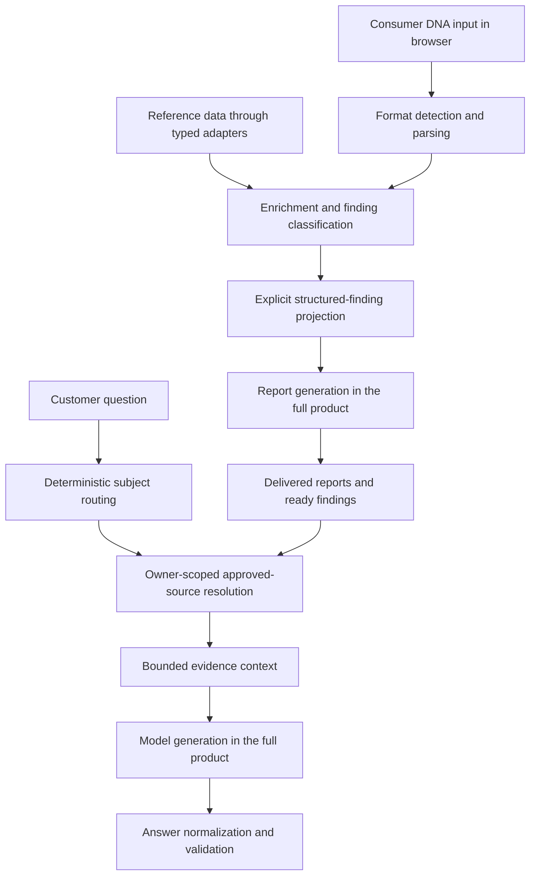

# Architecture and engineering decisions

The source in this repository shows two connected responsibilities: preparing structured findings from browser-side inputs and selecting approved evidence for a customer's question. The full product supplies the interface, service orchestration, database policies, reference-data releases, and model execution around these components.

## 1. Recognize the input before interpreting it

[genome-parser.ts](../src/lib/genome-parser.ts) handles several consumer export formats and exposes detection confidence with the result. Header evidence, delimiters, and column shapes are separate inputs to that decision. A count of parsed records is not represented as proof that an export is complete.

The [adversarial test suite](../src/lib/__tests__/genome-parser-adversarial.test.ts) includes empty input, binary junk, wrong delimiters, missing headers, truncated exports, mixed shapes, long identifiers, and SQL-like text treated as data. Its fixtures are intentionally small synthetic examples.

## 2. Define the transfer contract explicitly

[structured-findings-contract.ts](../src/lib/narration/structured-findings-contract.ts) constructs a narration payload through typed field selection and schema validation. Arbitrary browser objects do not become the payload merely because they are reachable in memory.

The implementation separates the larger structured evidence set from the smaller narrative selection, with string and item-count limits. This permits a concise narrative without silently redefining the complete underlying finding set. [Tests](../src/lib/narration/__tests__/structured-findings-contract.test.ts) cover 821 synthetic findings, provider-native identifiers, rejected raw-state serialization, the free Welcome projection, and bounded narrative selection.

## 3. Resolve evidence before asking a model to explain it

[routing.ts](../src/server/customer-chat/routing.ts) distinguishes personal report questions, population-level questions, product questions, and cases needing another route. [sources.ts](../src/server/customer-chat/sources.ts) then builds the approved evidence for that subject.

The source resolver keeps several decisions explicit:

- Customer/report references are resolved through owner-scoped queries.
- Current-report membership and exact structured identities determine whether a finding supports the question.
- Historical evidence is a distinct fallback, not silently presented as current evidence.
- Ambiguous matches, missing records, and failed store reads remain different states.
- Excerpts are bounded and customer-identifying fields are filtered from selected content.

The [regression suite](../src/server/customer-chat/__tests__/sources.test.ts) uses an in-memory database-interface double. It exercises these decisions without connecting to production. That proves the resolver's behavior against the fixtures, not the production database's independent authorization policies.

## 4. Preserve where the evidence came from

[evidence-provenance.ts](../src/lib/performance-suite/evidence-provenance.ts) derives evidence labels from supplied source metadata. Its [tests](../src/lib/performance-suite/__tests__/evidence-provenance.test.ts) explicitly check that accession numbers and citations are not invented.

[evidence-projection.ts](../src/lib/narration/evidence-projection.ts) makes bounded text projection explicit. When an excerpt must be shortened, the result records that transformation instead of silently treating it as the whole source.

These are software contracts for representing evidence. A passing unit test does not independently establish the medical validity of an evidence classification.

## 5. Keep reference-data work separate from customer data

The [enrichment engine](../src/lib/enrichment-engine.ts) consumes a common [data-source contract](../src/lib/data-sources/types.ts). Source-specific adapters keep data representation separate from the common matching flow. The registry exposes the ClinVar path; CPIC and NIH ODS are disabled in this snapshot, and the NIH ODS query is an extension point that returns no findings. The [reference-bundle implementation](../src/lib/reference-bundle.ts) demonstrates signature-verification and versioned artifact loading, while [browser storage](../src/lib/indexed-db.ts) supports local persistence.

These supporting implementations are present for source inspection and type completeness. The reference artifacts, signing key, production services, and browser runtime are not included, and this package does not execute the full reference-data loading or enrichment workflow.

## Tradeoffs visible in the code

- **Explicit contracts over unrestricted object transfer:** more deliberate field mapping, with a smaller and inspectable data boundary.
- **Deterministic evidence selection before generation:** clear ownership and identity decisions before model-dependent explanation.
- **Bounded search and context:** predictable work and context size, with explicit ambiguity and incomplete-evidence states.
- **Synthetic, service-independent regression tests:** reproducible inspection of difficult cases without customer data or paid model access.

The wider application continues to be developed and refined. This snapshot exposes these concrete mechanisms without presenting an isolated component test as acceptance of every product workflow.
